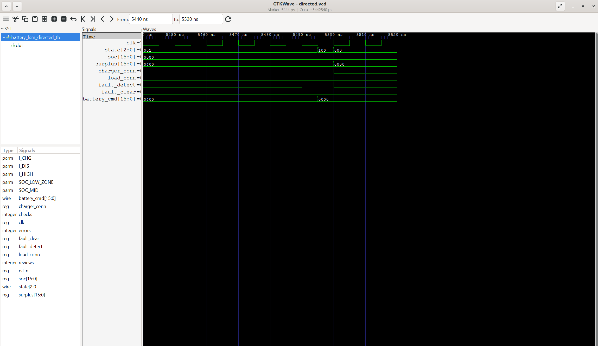
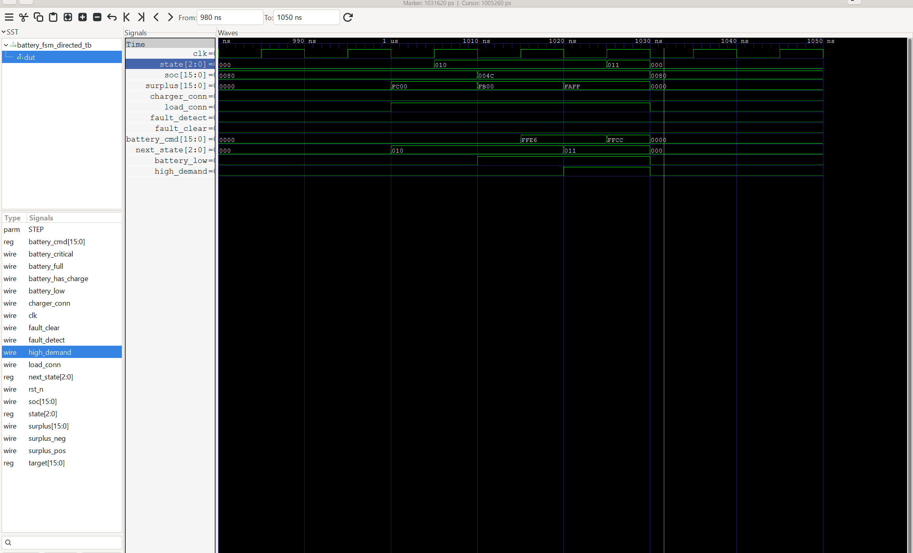
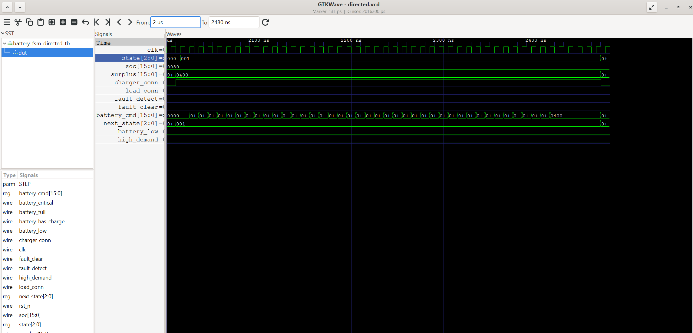
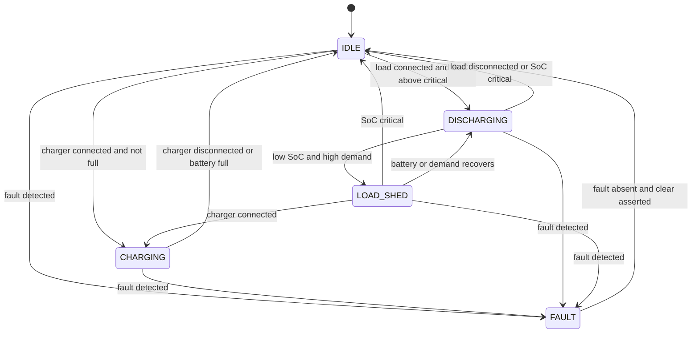

# Smart Energy Optimizer

[](https://www.mathworks.com/products/simulink.html)
[](https://github.com/Kami1230/Smart-Energy-Optimizer)
[](https://github.com/Kami1230/Smart-Energy-Optimizer)

A five-state battery and microgrid controller for a simulated microgrid or event venue. It decides when to charge, discharge, shed non-critical load, remain idle, or enter a fault state.

The project will implement the same controller specification in three forms:

| Version | Status | Focus |
|---|---|---|
| V1 - Simulink and SystemVerilog | **IN PROGRESS** | Modeling, RTL, fixed-point arithmetic, verification |
| V2 - Arduino | **PLANNED** | Embedded C, sensors, actuators, model calibration |
| V3 - FPGA | **PLANNED / STRETCH** | Synthesis, interfaces, timing, clock-domain basics |

## Current Status

V1 combines a Simulink microgrid model with a SystemVerilog controller using signed Q8.8 power and state-of-charge values. The output is a rate-limited battery command.

| Milestone | Status |
|---|---|
| M1 - Simulink plant, reference controller, and logging | **DONE** |
| M2 - Five-state RTL FSM and regression tests | **DONE** |
| M3 - Closed-loop plant scenarios and plots | **NOT STARTED** |

Current verification results:

- **91 directed checks passed**
- **0 mismatches across 199 compared samples**
- The first two of 201 loaded samples are skipped for the two-clock pipeline latency; tolerance is +/-16 LSB

## Verification Waveforms



**Fault cutoff:** entering `FAULT` immediately forces `battery_cmd` to zero.



**High-demand boundary:** `LOAD_SHED` begins only when the deficit moves past the configured threshold.



**Command ramp:** the Q8.8 battery command advances toward its target at the configured rate.

## Controller Specification

The five states are `IDLE`, `CHARGING`, `DISCHARGING`, `LOAD_SHED`, and `FAULT`.
The Simulink model provides the plant and reference output; exported vectors verify the RTL FSM and its battery-command rate limiter.



Fault detection has priority over normal operation and immediately sets the battery command to zero.

### Shared Q8.8 values

All three versions will use the same transition table, constants, and exported test vectors.

| Constant | Integer value | Engineering value |
|---|---:|---:|
| `SOC_FULL` | 230 | approximately 0.90 |
| `SOC_LOW` | 77 | approximately 0.30 |
| `SOC_CRITICAL` | 26 | approximately 0.10 |
| `SURPLUS_THRESHOLD` | +/-512 | +/-2.00 A |
| `HIGH_DEMAND` | 1280 | 5.00 A |
| Command step | 26 per clock | approximately 0.102 A per clock |

For Q8.8 values: `real value = integer value / 256`.

## Known Open Items

- The +/-2 A surplus dead zone is defined but not applied in the RTL.
- `CHARGING` and `DISCHARGING` do not clamp the battery-command sign.
- RTL high demand uses net deficit; the design document uses `Iload`.
- The M3 closed-loop plant simulation has not started.

## Roadmap

### V1 - Simulink and SystemVerilog

Complete the dead-zone decision, build the closed-loop testbench plant, and run six scenarios:

1. High solar and low load
2. Low solar and high load
3. Battery nearly full
4. Battery nearly empty
5. Rapidly changing demand
6. Extended low generation

V1 is complete when these scenarios produce plots for SoC, surplus, state, and command, and the repository is tagged `v1.0-sim`.

### V2 - Arduino

- Port the V1 FSM and Q8.8 contract to C.
- Run the V1 vectors through the Arduino over serial and compare results.
- Add controls, state indicators, current sensing, load switching, PWM output, and serial logging.
- Compare hardware traces with Simulink to calibrate the model.

### V3 - FPGA

- Synthesize `battery_fsm.sv` on a low-cost FPGA board.
- Use the Arduino as the plant and sensor interface over UART or SPI.
- Add tested synchronizer, debouncer, UART, and PWM modules.
- Record synthesis, timing, and resource reports.

Later stretch goals include Stateflow, wind generation, load-priority tiers, and a results dashboard.

## Run the V1 Tests

Requirements: Icarus Verilog for RTL simulation and MATLAB/Simulink for the model and vector export.
Run all commands from the repository root because the testbenches load `vectors/*.hex` using relative paths.

### Directed FSM test

```bash
iverilog -g2012 -o directed.vvp rtl/battery_fsm_pkg.sv rtl/battery_fsm.sv tb/battery_fsm_directed_tb.sv
vvp directed.vvp
```

Expected summary:

```text
91 checks, 0 failures, 3 review items
ALL CHECKS PASSED
```

The review items correspond to the dead-zone and command-sign issues listed above.

### Simulink-vector comparison

```bash
iverilog -g2012 -o tb.vvp rtl/battery_fsm_pkg.sv rtl/battery_fsm.sv tb/battery_fsm_tb.sv
vvp tb.vvp
```

Expected result: **0 mismatches across 199 compared samples**. The first two samples are skipped while the pipeline fills.

### Regenerate the vectors

Open `SmartEnergyOptimizer.prj` in MATLAB and run:

```matlab
run("scripts/export_fsm_vectors.m")
```

## Repository Layout

```text
SmartEnergyOptimizer.slx     Simulink plant and reference controller
rtl/                        SystemVerilog controller
tb/                         RTL testbenches
vectors/                    Shared Q8.8 regression vectors
scripts/                    MATLAB vector-export script
docs/                       Design notes and waveform results
archive/                    Previous models and retired test scaffolds
fw/                         Arduino firmware (planned)
fpga/                       FPGA integration (planned)
```

The V1 tag `v1.0-sim` will define the specification that V2 and V3 must match.
